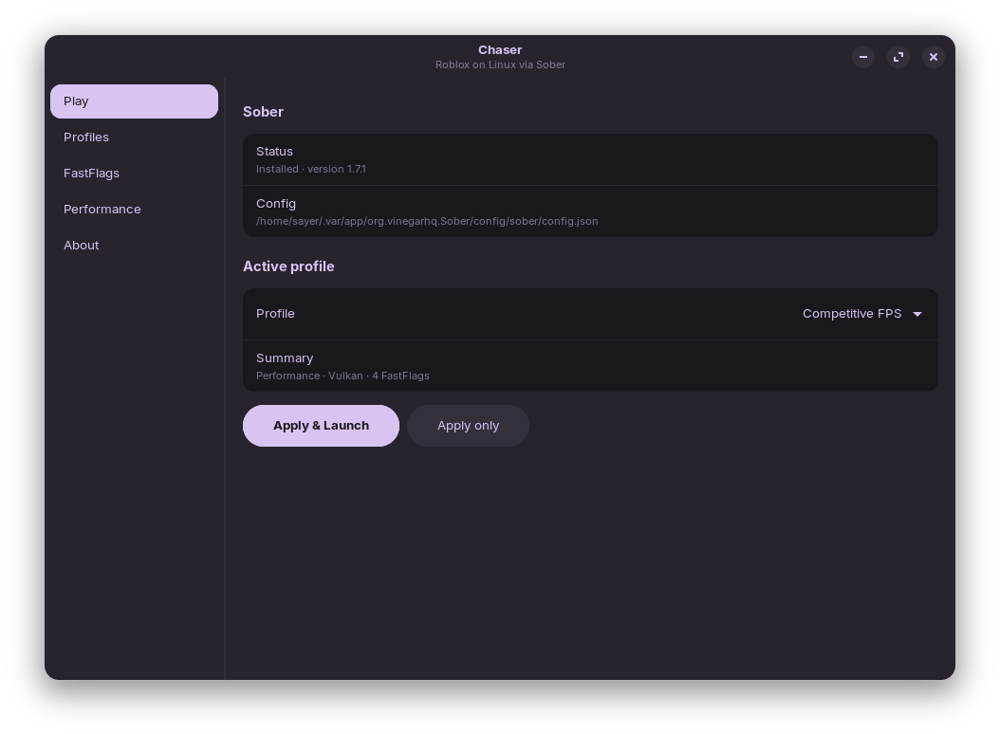
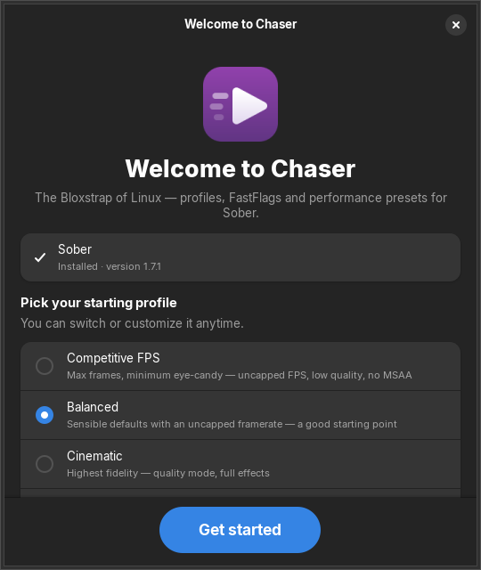
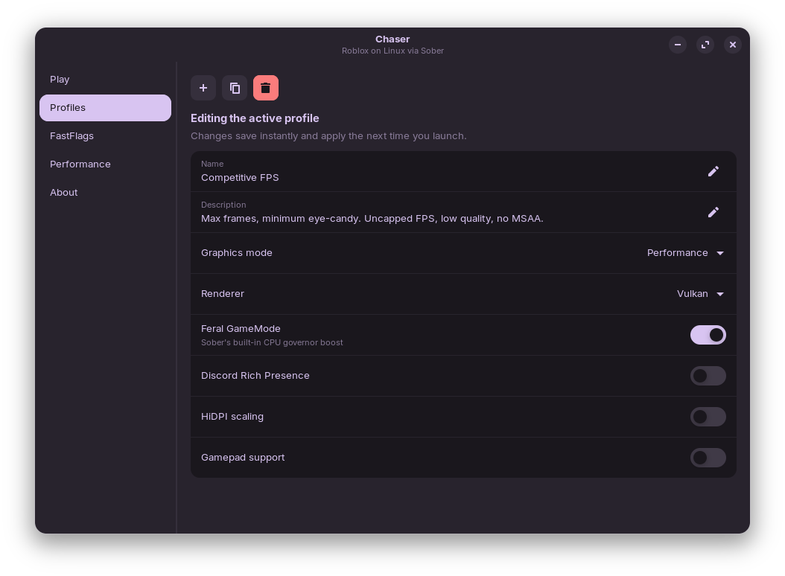
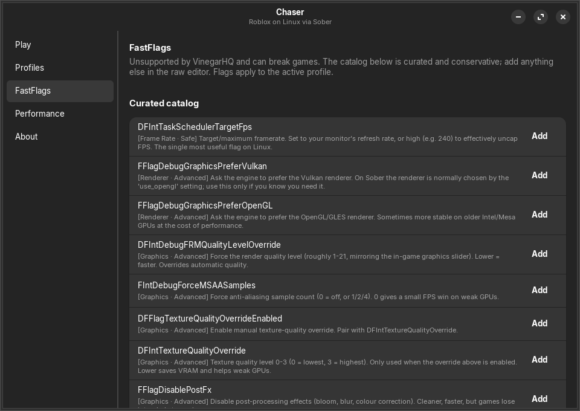

<p align="center"></p>

<h1 align="center">Chaser</h1>

<p align="center"><code>flatpak install --user ./chaser.flatpak</code></p>

A GTK4 launcher and manager for [Sober](https://sober.vinegarhq.org/), the way to play Roblox on Linux: what Bloxstrap is on Windows.

Sober runs the x86-64 Android build of Roblox natively, which sidesteps the
Hyperion anti-cheat that closed off Wine. It is deliberately a minimal runtime,
and VinegarHQ leaves the launcher and config layer to the community. Chaser is
that layer: profiles, a FastFlag catalog, performance presets, launch
orchestration and config backups, without touching the runtime or the Roblox
client.

| The home screen | First-run onboarding |
|---|---|
|  |  |

## Install

Needs [Sober](https://flathub.org/apps/org.vinegarhq.Sober) via Flatpak
(`flatpak install flathub org.vinegarhq.Sober`). Take `chaser.flatpak` from the
[latest release](https://github.com/PointOfPressure/chaser/releases/latest),
then:

```sh
flatpak install --user ./chaser.flatpak
flatpak run org.chaser.Chaser        # or launch Chaser from the app menu
```

## Usage

The GUI and the CLI do the same things.

```
chaser status              # Sober install + active profile
chaser init                # create the built-in presets
chaser profiles            # list profiles (* = active)
chaser apply <slug>        # write a profile into Sober's config
chaser launch [--profile <slug>] [--dry-run] [uri]
chaser config [--path]     # print Sober's parsed config
chaser fflags              # list the curated FastFlag catalog
chaser sessions            # play history: place, universe, server, duration
chaser doctor              # audit Sober's FastFlags: live, ignored, or fake
chaser import <file>       # merge a shared FastFlag preset, dropping fakes
```

## FastFlags

Since 29 September 2025 the Roblox client honours only the flags on [Roblox's
published allowlist][allowlist], eighteen of them. Everything else set through a
config file is silently ignored: no error, no warning, it simply does nothing.
That is why most FastFlag guides no longer work, and why a good share of the
flags traded around in presets were never real names to begin with.

Chaser checks every flag against two independent dumps of the Roblox engine's
own symbols before it reaches Sober, and gives one of four verdicts:

| Verdict | Meaning |
|---|---|
| **Live** | Real and allowlisted. The client honours it. |
| **Ignored** | A real engine flag, but not allowlisted, so the client discards it. |
| **Wrong prefix** | The name exists, but under a different prefix (`FFlag` vs `DFFlag`). |
| **Not a real flag** | No such symbol in any Roblox build. Someone invented it. |

```
$ chaser doctor
Auditing 9 FastFlags in ~/.var/app/org.vinegarhq.Sober/config/sober/config.json

  FAKE     DFFlagDebugRenderForceTechnologyVoxel  = true   no such flag in any Roblox build
  LIVE     DFFlagTextureQualityOverrideEnabled    = true
  LIVE     DFIntDebugFRMQualityLevelOverride      = 1
  IGNORED  DFIntTaskSchedulerTargetFps            = 60     not on Roblox's allowlist
  LIVE     DFIntTextureQualityOverride            = 0
  FAKE     FFlagDisablePostFx                     = true   no such flag in any Roblox build

  4 live, 1 ignored, 4 not real.
  5 of 9 flags in this config do nothing.
```

`chaser import preset.json` merges a preset someone sent you, dropping the
invented flags rather than writing them into your profile. `--all` keeps them.

<details><summary>Where the ground truth comes from</summary>

Two sources, because neither alone is enough:

- **`core/data/flags.txt`**: every flag symbol in an unstripped Roblox Studio
  build, as `PREFIX:Name`. The only source that knows a flag's prefix, so it is
  what catches `FFlag`/`DFFlag` mix-ups.
- **`core/data/player-flags.txt`**: bare flag names from a current Player
  client offset dump, covering the ~1500 flags newer than that Studio build.

A flag is treated as real if either source knows it. The allowlist overrides
both: a platform-specific entry missing from a dump is still allowlisted, and
is never reported as fabricated.

</details>

<details><summary>Why other tools claim thousands of modifiable flags</summary>

Because they do not use the config file. Windows tools that advertise ~14,000
modifiable flags write values straight into the running client's memory using
dumped offsets, which sidesteps the allowlist entirely. That is a different
mechanism with different risks, it is Windows-only, and Chaser does not do it.
Through a config file, the only route Sober offers, the allowlist is the whole
truth.

</details>

## How it works

Chaser does not touch the Roblox client or Sober's runtime. It:

1. reads and writes `~/.var/app/org.vinegarhq.Sober/config/sober/config.json`,
   Sober's own settings surface including its `fflags` object, preserving the
   `// !!! STOP !!!` header and any keys it does not understand;
2. backs the file up to `~/.config/chaser/backups` before each write, keeping
   the newest 20, and writes atomically via temp file and rename;
3. launches Sober with `flatpak run org.vinegarhq.Sober`, injecting environment
   through `--env=`.

A hidden desktop entry claims `x-scheme-handler/roblox`, so a Play link from
the Roblox website can route through Chaser: it applies the active profile,
then hands the URI to Sober. Sober claims the same scheme, so pick whichever you
want as the default handler:

```sh
xdg-mime default org.chaser.Chaser.handler.desktop x-scheme-handler/roblox
xdg-mime default org.vinegarhq.Sober.desktop x-scheme-handler/roblox   # to undo
```

<details><summary>All features</summary>

- Launch writes the active profile to Sober first, so what you see is what runs.
- First-run onboarding checks the Sober install and sets a starting preset.
- Profiles: named bundles of graphics mode, renderer, GameMode, RPC, HiDPI and
  gamepad toggles, FastFlags and launch environment.
- Presets: Competitive FPS, Balanced, Cinematic, and Potato for weak GPUs, all
  built only from flags the client actually honours.
- FastFlag catalog built from Roblox's official allowlist, risk-tagged, with a
  raw JSON editor.
- Every flag validated against the engine's own symbols (see FastFlags above).
- Import shared FastFlag presets with the invented flags stripped out.
- Play history parsed from Sober's logs: place, universe, server instance and
  how long each visit lasted.
- Registers as a `roblox://` link handler.
- Performance page: apply a preset, toggle MangoHud, set environment variables.
- Sober's JSONC `config.json` is parsed with its comment header and unmanaged
  keys preserved, written atomically, and backed up before every change.
- GTK4 and libadwaita. No Electron, no web view.
- CLI with everything the GUI does.

| Profiles editor | FastFlags |
|---|---|
|  |  |

</details>

<details><summary>Building from source</summary>

Needs GTK4 4.14 or newer and libadwaita 1.5 or newer (Ubuntu 24.04, Fedora 40,
or anything later), and Rust.

```sh
git clone https://github.com/PointOfPressure/chaser.git
cd chaser
# build deps on Debian/Ubuntu/Zorin:
sudo apt install libgtk-4-dev libadwaita-1-dev
cargo build --release
```

Binaries land in `target/release/`: `chaser-gui` is the app, `chaser` the CLI.
Run in place with `./target/release/chaser-gui`, or install:

```sh
sudo install -Dm755 target/release/chaser-gui /usr/local/bin/chaser-gui
sudo install -Dm755 target/release/chaser /usr/local/bin/chaser
install -Dm644 data/org.chaser.Chaser.desktop ~/.local/share/applications/org.chaser.Chaser.desktop
install -Dm644 data/icons/org.chaser.Chaser.svg ~/.local/share/icons/hicolor/scalable/apps/org.chaser.Chaser.svg
```

To build the Flatpak instead:

```sh
flatpak install flathub org.gnome.Sdk//49 org.gnome.Platform//49 org.freedesktop.Sdk.Extension.rust-stable//25.08
flatpak-builder --user --install --force-clean build-dir packaging/org.chaser.Chaser.yml
```

</details>

## Not affiliated

An unofficial community project, not affiliated with Roblox or VinegarHQ. It
edits Sober's configuration and launches it. It does not modify the Roblox
client, load modified APKs, or attempt to bypass anti-cheat.

## Licence

MIT, see [LICENSE](LICENSE).

[allowlist]: https://devforum.roblox.com/t/allowlist-for-local-client-configuration-via-fast-flags/3966569
